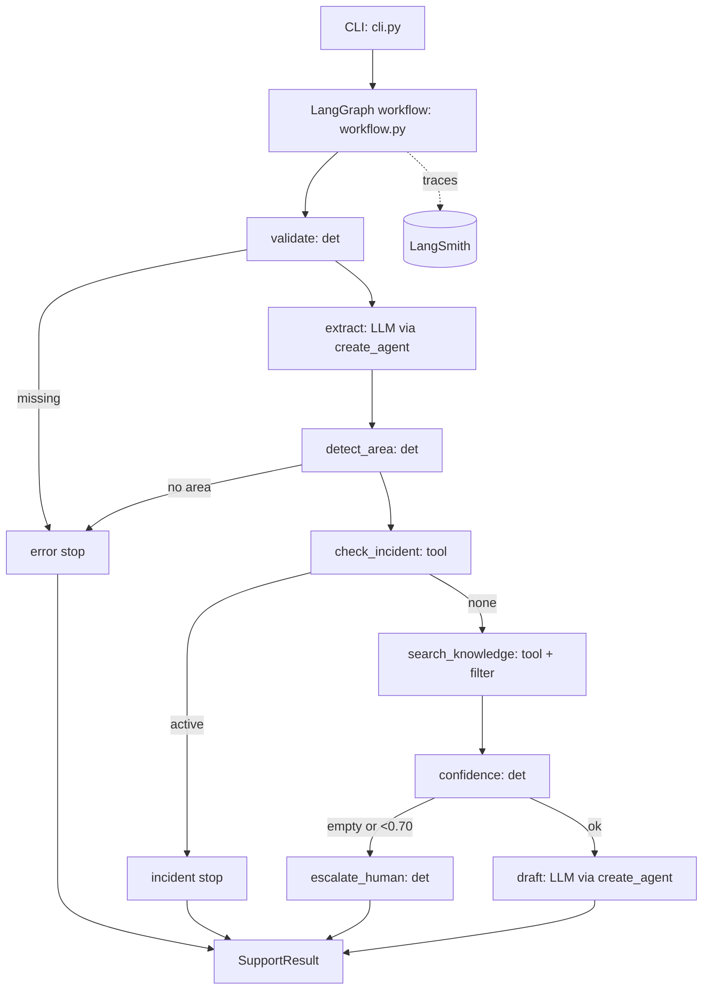

# Software Design Document: support-copilot
_Date: 2026-10-12_

## Human Quality Gate
- Status: Approved with conditions
- Required reviewers: project owner (engineer accountable for architecture and risk)
- Artifact revision: draft 3 (2026-10-12), amends DES-027 and Section 9 only (draft 2: term coverage; draft 3: prefix matching)
- Decision/conditions: Draft 1 approved by "design ok" before planning; the adversarial review (cg-design Step 6) was not run and the owner accepted proceeding without it. Draft 2: the confidence formula was changed from weighted score to term coverage after the R1 measurement (0.57 and 0.50 against the 0.70 cutoff). The owner chose "Term coverage, keep 0.70" (asked twice, same answer). Draft 3: live extraction showed the real model's terms ('expiration', 'resend') scored TCK-1002 at 0.60; the owner chose "Prefix matching in confidence" with the cutoff kept at 0.70. A material SDD edit resets this gate to Pending.
- Evidence: conversation record; R1 and R6 measurements in the plan (Risks table and Phase 4 note)
- Approver/time: project owner, 2026-10-12

## Section 1 — Introduction & Purpose

### 1.1 Background
Tier 1 support submits product questions through Jira. One expert manually searches documentation, answers or escalates. The Product Support Copilot is a stateless CLI that takes one ticket and returns one of four outcomes (DES-001): a cited draft response, a stop with an error for missing data, a stop at a known incident, or an escalation to the owning team. The expert keeps final judgment. It serves OBJ-001 and OBJ-002.

### 1.2 Scope
- A CLI (`--ticket <id>` or free text) running one LangGraph workflow per ticket (DES-002).
- Two LLM steps, extraction and drafting, using Anthropic Claude through LangChain. Everything else is deterministic: area detection, validation, incident check, filtering, confidence and escalation.
- Fixture-backed tools for tickets, incidents, knowledge and ownership.
- Deterministic pytest unit tests with a fake chat model, and LangSmith tracing when a key is present.
- uv for dependency management and running.

### 1.3 Out of Scope
- LLM-as-judge evaluation, added after manual testing (Q-007).
- The `reasoning` output field (v2).
- Conversation state, UI, real Jira or Notion integration.
- Changes to fixture data or the `search_knowledge` scoring.

### 1.4 Requirements Baseline
- Source: `docs/requirement/requirements.md` (REQ-F-001 to F-010, REQ-NF-001 to NF-005, US-001 to US-004, AC-001 to AC-010). No analysis document exists; design works directly from the requirements.
- **Known gap:** REQ-F-001, F-002, F-008, F-009, NF-002 have no dedicated AC. This design proposes AC-011 to AC-015 (Section 7.1); they are not yet in `requirements.md`. REQ-F-010 moves to Constraints and REQ-NF-005 is N/A.

## Section 2 — System Architecture

### 2.1 High-Level Architecture



The description check (DES-003) runs before the LLM call; area detection runs after extraction (DES-004) but depends only on the title and description (REQ-F-003a).

### 2.2 Components
- `cli.py` (DES-005): parses arguments, builds the ticket, calls the workflow, prints JSON, exits non-zero on `status = error`.
- `workflow.py` (DES-002): the `StateGraph`, node functions and routing edges. Pure orchestration.
- `llm.py` (DES-006): builds the two `create_agent` instances (extract, draft) with `response_format` schemas. Model name from config.
- `tools.py` (existing, DES-007): `FixtureTools` plus `@tool` wrappers for the four fixtures.
- `rules.py` (DES-008): deterministic area detection, document filter and confidence.
- `types.py`: extended with `SupportResult` and the extraction schema.

### 2.3 Interfaces
- Workflow to LLM: Anthropic via `langchain-anthropic`, key from `ANTHROPIC_API_KEY`, 4 s timeout and one bounded retry (DES-017, DES-019). Failures become `status = error`.
- Workflow to fixtures: in-process async calls to `CopilotTools`, no network.
- Operator: the CLI (DES-005) and LangSmith env vars for tracing.

### 2.4 Architecture Principles
- Deterministic by default; the LLM only extracts and drafts (DES-009).
- Guardrails live in graph edges, not in prompts.
- Depend on the `CopilotTools` and `LanguageModel` Protocols so tests can swap fakes.

## Section 3 — Workflow / Use Cases

### 3.1 Main flow (DES-002, DES-010)

```mermaid
sequenceDiagram
    participant U as CLI
    participant W as Workflow
    participant L as Claude (extract/draft)
    participant T as Fixture tools
    U->>W: ticket (title, description, metadata)
    W->>W: validate description (REQ-F-003)
    W->>L: extract ticket_details
    L-->>W: TicketDetails
    W->>W: detect_area from ownership terms
    W->>T: find_active_incidents(area)
    alt active incident
        W-->>U: ok, escalate=false, incident + owner, no response
    else none
        W->>T: search_knowledge(query)
        W->>W: keep approved+internal; score confidence
        alt empty or confidence < 0.70
            W->>T: find_owner(area)
            W-->>U: escalate=true, owner team/channel, no response
        else enough evidence
            W->>L: draft(ticket_details, documents)
            L-->>W: response text
            W-->>U: ok, response, citations, confidence
        end
    end
```

### 3.2 Outcomes
| Outcome | Trigger | `status` | `escalate` | Response |
|---|---|---|---|---|
| Missing data | empty description, or no area detected | error | false | none |
| Known incident | non-resolved incident in the area | ok | false | none; incident and owner included |
| Escalation | no approved hits, or confidence < 0.70 | ok | true | none; owner included |
| Answer | enough approved evidence | ok | false | drafted, cited |
| Dependency failure | LLM or tool error | error | false | none |

### 3.3 Notes
- Citations are the ids of documents passed to the draft step; any id outside that set is dropped by a final check (DES-011).
- Escalation with no owner found sets `owner = None` and adds a note.
- Expected fixture outcomes (TCK-1001 and TCK-1002 answer, TCK-1003 incident stop) are test targets (AC-001 to AC-003), not yet verified.

## Section 4 — Data Models

Frozen dataclasses stay in `types.py`. Pydantic models are used only for LLM structured outputs (DES-012).

**Unchanged:** `SupportTicket`, `KnowledgeDocument`, `ServiceOwner`, `Incident`.

**New LLM schemas:**
- `TicketDetails`: `summary: str`, `symptoms: list[str]`, `product_terms: list[str]`. `product_terms` feeds the knowledge query; it does not decide the area (Q-012).
- `DraftAnswer`: `response: str`. The model does not set citations or confidence.

**Output contract `SupportResult` (replaces `SupportDecision`, DES-013):**

| Field | Type | Notes |
|---|---|---|
| `status` | `"ok"` or `"error"` | |
| `error_message` | `str or None` | names missing fields on a stop |
| `escalate` | `bool` | true only on escalation (AS03) |
| `response` | `str or None` | set only on an answer |
| `citations` | `list[Citation]` | `Citation(source_id, reason)` |
| `confidence_score` | `float or None` | 0 to 1, set once search ran |
| `owner` | `ServiceOwner or None` | on escalation and incident stop |
| `incident` | `Incident or None` | on incident stop |
| `area` | `str or None` | detected area |
| `notes` | `list[str]` | e.g. "no owner found" |

`Evidence` is renamed `Citation`; `SupportAction` is removed.

**Workflow state (DES-014):** a per-run `TypedDict` with `ticket`, `details`, `area`, `incident`, `documents`, `confidence_score`, `response`, `result`. Never persisted; no thread or conversation id.

**Compatibility:** breaks `handle_support_ticket`'s return type and `demo.py`; both are updated together. `tests/test_starter.py` is unaffected.

## Section 5 — API Endpoints

No network API in v1. The external interface is the CLI (DES-005).

### 5.1 CLI contract
| Item | Specification |
|---|---|
| Command | `uv run python -m support_copilot.cli` |
| Fixture input | `--ticket TCK-1001`; an unknown id returns `status=error` |
| Free-text input | `--title "..." --description "..."`, or `--description -` for stdin; optional `--requester-role`, `--created-at` |
| Exclusion | `--ticket` cannot be combined with `--title` or `--description` |
| Output | One JSON object on stdout matching `SupportResult` |
| Diagnostics | Logs on stderr only; keys never appear in either stream (AC-010) |
| Exit code | `0` for `status=ok` (including escalation and incident stop), `1` for `status=error`, `2` for argument errors |
| Auth | `ANTHROPIC_API_KEY` for live runs; tracing needs `LANGSMITH_API_KEY` and `LANGSMITH_TRACING=true` |
| Config | `COPILOT_MODEL` sets the Claude model name, with a default (DES-015) |

### 5.2 Programmatic interface
`handle_support_ticket(ticket, tools, model=None) -> SupportResult` is the single entry point used by the CLI and tests; `model` lets tests inject a fake chat model (DES-016).

### 5.3 Versioning and errors
- JSON field names are the contract. Adding fields is compatible; renaming or removing one needs a note in this SDD.
- Every failure path prints a valid result with `status="error"`; no stack traces on stdout.
- No CLI-level retries; the workflow owns one bounded LLM retry (DES-017).

### 5.4 Tooling (DES-018)
- Dependencies in `pyproject.toml` (`langchain`, `langgraph`, `langchain-anthropic`, `langsmith`), dev group (`pytest`, `pytest-asyncio`), and a committed `uv.lock`.
- No `[project.scripts]` entry; the project has no build backend.

## Section 6 — Non-functional Requirements

| Area | Decision (DES) |
|---|---|
| Performance | One ticket in at most 10 s at p95 (REQ-NF-001). Two LLM calls plus in-process lookups; 4 s timeout per call; stop paths skip later LLM calls (DES-019). No caching. |
| Security | Keys from the environment only, never logged or printed (AC-010). Only approved, internal documents reach the prompt (DES-020). Ticket text is delimited data in prompts, and the draft cannot add citations. No real PII; real PHI would need review (REQ-NF-005, N/A). |
| Consistency | Stateless; fixtures are read-only and re-read per run; no transactions. |
| Availability | CLI with no uptime SLO; a provider outage gives `status=error` with a clear message (DES-021). |
| Scalability | N/A for v1; runs are independent and safe in parallel. |
| Cost | At most two Claude calls per ticket, none on error, incident or escalation paths; only the top 3 documents in the prompt (DES-022). |
| Reliability | One retry with backoff on timeout, 429 or 5xx (DES-017). Validation and parse failures are not retried. Malformed structured output gives `status=error`. Empty fields, unknown area and missing owner have defined outcomes (3.2). |
| Observability | LangSmith traces per node when enabled (REQ-NF-004); run metadata includes ticket id and outcome. One structured stderr log line per node with no ticket text or secrets (DES-023). |

## Section 7 — Test Strategy

### 7.1 Requirement Coverage
Proposed new criteria (not yet in `requirements.md`): AC-011 CLI modes and exit codes (REQ-F-001); AC-012 valid extraction output (REQ-F-002); AC-013 output schema (REQ-F-008); AC-014 each fixture exposed as a tool (REQ-F-009); AC-015 tool or LLM failure gives `status=error` (REQ-NF-002). REQ-F-010 moves to Constraints; REQ-NF-005 is N/A.

| AC | DES | Boundary | Observable fact | Primary level | Secondary | Data | Tolerance | Evidence |
|---|---|---|---|---|---|---|---|---|
| AC-001 | 002, 010 | `handle_support_ticket` | ok, KB-101 cited, confidence >= 0.70 | integration | none | TCK-1001, fake model | exact fields | pytest result |
| AC-002 | 020 | same | cites KB-103, never KB-102 | integration | none | TCK-1002 | exact | pytest result |
| AC-003 | 010 | same | INC-2041, no search call, no draft call | integration | none | TCK-1003, call recorder | exact | pytest result |
| AC-004 | 003 | same | error naming `description`; CLI exit 1 | unit | integration (CLI exit code) | empty description | exact | pytest result |
| AC-005 | 004, 008 | `rules.detect_area` | error naming `area` | unit | none | text with no area terms | exact | pytest result |
| AC-006 | 010 | workflow | escalate true, owner, no draft | integration | none | billing ticket, no billing docs | exact | pytest result |
| AC-007 | 008 | `rules.confidence` | same input gives same score; below 0.70 escalates | unit | none | fixed doc scores | exact | pytest result |
| AC-008 | 020 | `rules.filter_docs` | no unapproved ids anywhere | unit | none | mixed KB set | exact | pytest result |
| AC-009 | 019 | CLI, live | <= 10 s p95 | performance | none | 3 fixtures, 20 runs | p95 | timings plus LangSmith |
| AC-010 | 023 | CLI | trace exists, key absent from output | security | none | fake key value | exact string scan | scan test plus trace |
| AC-011 | 005 | CLI | each input mode and exit codes | integration | none | fixture id, free text, stdin | exact | pytest result |
| AC-012 | 006 | extract node | valid `TicketDetails` from fake model | unit | none | canned model output | schema | pytest result |
| AC-013 | 013 | result | all fields present and typed | contract | none | all five outcomes | schema | pytest result |
| AC-014 | 007 | tools | each fixture reachable as a tool | contract | none | four fixtures | exact ids | pytest result |
| AC-015 | 021 | workflow | tool or model failure gives `status=error` | resilience | none | raising fakes | exact | pytest result |

### 7.2 Test Levels and Boundaries
Only the seven supported levels are used. Unit covers `rules.py` and nodes. Integration drives the full graph with fakes. Contract covers the output schema and tool wrappers. Resilience injects failing fakes. Security and performance are live checks (AC-009, AC-010) and stay manual in v1.

### 7.3 Test Data and Determinism
- pytest with a fake chat model returning canned structured output; no network, clock or randomness.
- Fixtures read from `../fixtures/`; extra cases use in-memory tool fakes.
- Shared fixtures (fake model, tool recorder, fixture tools) live in `tests/conftest.py`; parametrized tests cover the outcomes and fixture tickets (DES-024).
- `pytest-asyncio` runs the async tests.

### 7.4 Positive, Negative, and Failure Paths
All five outcomes, plus malformed model output, an LLM timeout then retry, and a missing owner.

### 7.5 Execution and Evidence
- Gate: `uv run pytest` (offline, deterministic). Single test: `uv run pytest tests/test_workflow.py::test_name`.
- Live checks carry a `live` marker, skipped unless `ANTHROPIC_API_KEY` is set. Timings and trace links are recorded in PR notes.
- A reviewer reruns the same command and reaches the same pass/fail.
- `tests/test_starter.py` (unittest) is still collected by pytest.

## Section 8 — Design Decisions & Tradeoffs

| ID | Decision | Alternatives | Rationale and tradeoff |
|---|---|---|---|
| DES-025 | Graph with deterministic nodes and two `create_agent` LLM nodes | Free-form tool agent; plain Python | Edges guarantee the incident stop and no-draft-on-escalate. Cost: more dependencies and a state schema. |
| DES-026 | Area detected from `ownership.json` area names, no LLM | LLM extraction; hand-written keyword dict | Deterministic, testable, new areas work automatically (Q-012). Cost: synonyms don't match by themselves, so detection leans on the title; no match gives a clarification error. |
| DES-027 | Retrieval-based confidence as term coverage with 5-letter prefix matching (amended in drafts 2 and 3) | LLM self-reported; report-only; weighted score over the maximum title weight | Reproducible and gates escalation without the model grading itself (Q-003). The weighted formula measured 0.57 and 0.50 on the correct documents for TCK-1001 and TCK-1002, so it could never pass the 0.70 cutoff; coverage measured 0.86 and 1.00. Cost: measures retrieval match, not answer quality (the later evals cover that), and does not separate documents that share common terms, so the existing search ranking still picks the document. |
| DES-028 | Filter to approved and internal before scoring | Pass everything and let the model weigh | Keeps stale content like KB-102 out (Q-004). Cost: a correct draft-only document is never used. |
| DES-029 | Citations come from documents passed to the draft step | Model-generated citations | Prevents invented sources. Cost: unused passed documents may be cited, so cite only top-scoring ones. |
| DES-030 | Validate before extraction | Extract first | Saves an LLM call on empty tickets (AC-004). Cost: small change from the spec's listed order. |
| DES-031 | `status=error` for missing data | A third "clarify" outcome | One machine-readable signal and exit code (Q-013). Cost: a user-fixable case carries an error status. |
| DES-032 | One bounded LLM retry only | Circuit breaker, fallback provider | Enough for a CLI. Cost: sustained outages just fail. |

## Section 9 — Algorithms

**Area detection (DES-008).** For each owner area, split its name on `-` into terms (`patient-portal` gives `patient`, `portal`). Tokenize the lowercased title and description with the existing `_terms`. An area matches when any of its terms appears. Choose the area with the most matched terms, breaking ties by `ownership.json` order. Weak spot: `patient` could match scheduling tickets; mitigate by ignoring terms shared by more than one area and preferring the longest term match.

**Confidence (DES-027, amended in draft 2).** For the top approved, internal document (ranked by the existing search score), `confidence = matched_terms / query_terms`: the share of query terms that appear in the document title or body, A term counts as found when it is one of the document's title or body terms, or (draft 3) when both it and a document term are at least 5 letters long and start with the same 5 letters, a crude stem so that "expiration" matches "expire" and "resend" matches "resending". The result is between 0 and 1 by construction, and 0.0 for an empty term set. Query terms come from the ticket title plus `product_terms`. The escalation cutoff stays at 0.70 and is named `CONFIDENCE_THRESHOLD`.

**Measured (R1):** the original weighted formula, `_score / (3 x terms)`, gave 0.57 (TCK-1001, KB-101) and 0.50 (TCK-1002, KB-103) and was replaced. Term coverage gave 0.86 and 1.00; TCK-1003's top document KB-104 gave 0.43; billing-like and unrelated queries gave 0.00 for every approved document.

**Measured with the real model's terms (R6, draft 3):** exact matching gave TCK-1001 0.83, TCK-1002 0.60 and TCK-1003 0.29 (the model returns phrases such as "invitation expiration" and "resend invitation"); prefix matching gave 0.83, 1.00 and 0.57. Adding the ticket description terms to the query was worse (0.29, 0.27, 0.11) and was rejected.

**Risk:** coverage ignores term weight and the tokenizer has no stemming, so scores depend on the query terms the extraction step produces; the 5-letter prefix rule reduces this but can occasionally match an unrelated word that shares a prefix. Documents sharing common terms score similarly (KB-101 scored 0.75 on the TCK-1002 query), so correctness of the cited document still rests on search ranking.

## Section 10 — Boundaries

### Always Do
- Validate input at the CLI and workflow boundary before any LLM call.
- Write the failing test first, then the code (pytest, offline by default).
- Keep guardrails in graph edges and `rules.py`, not in prompts alone.
- Return a complete `SupportResult` on every path, including errors.
- Commit atomically per phase once `uv run pytest` passes.
- Depend on the `CopilotTools` and `LanguageModel` Protocols, not `FixtureTools`.
- Keep functions under 70 lines.

### Ask First
- Any dependency beyond `langchain`, `langgraph`, `langchain-anthropic`, `langsmith`, `pytest`, `pytest-asyncio`.
- Changing output contract fields, the 70% threshold, or the confidence formula.
- Changing fixture files or the `search_knowledge` scoring.
- Adding a second LLM call, a fallback provider, or state across runs.
- Adding the evals (planned after manual testing).
- Changing `AGENTS.md` rules or `docs/policy/engineering_constitution.md`.

### Never Do
- Never commit or print `ANTHROPIC_API_KEY` or `LANGSMITH_API_KEY`, or log ticket text.
- Never pass deprecated, draft or restricted documents to the model or cite them.
- Never draft a response on an error, incident stop or escalation path.
- Never let the model choose citations, the area, the escalation decision or the confidence score.
- Never skip, delete or loosen a test to pass a gate.
- Never expose stack traces on stdout.
- Never touch `../typescript/` or the `../fixtures/` data.

## Section 11 — Requirement Mapping

| Design ID | Requirement / AC IDs | Decision or component | Verification strategy |
|---|---|---|---|
| DES-001 | OBJ-001, US-001 to US-004, AC-013 | The four outcomes plus dependency failure (3.2) | Output-schema contract test across all outcomes |
| DES-002 | REQ-F-010, AC-001, AC-003, AC-006 | LangGraph `StateGraph` workflow | Integration tests on the three fixtures and the escalation case |
| DES-003 | REQ-F-003, AC-004 | Description check before extraction | Unit test, plus CLI exit code check |
| DES-004 | REQ-F-003a, AC-005 | Area detection step | Unit test on no-match text |
| DES-005 | REQ-F-001, AC-011 | CLI (`--ticket`, free text, stdin, exit codes) | Integration test per input mode |
| DES-006 | REQ-F-002, REQ-F-007, AC-012 | `llm.py` with `create_agent` for extract and draft | Unit test with a fake chat model |
| DES-007 | REQ-F-009, AC-014 | `@tool` wrappers over the four fixtures | Contract test per fixture |
| DES-008 | REQ-F-003a, REQ-F-006a, AC-005, AC-007 | `rules.py`: area, filter, confidence | Unit tests with fixed inputs |
| DES-009 | OBJ-002 | Principle: LLM only extracts and drafts | Review, plus no-draft-call assertions in AC-003, AC-004, AC-006 |
| DES-010 | REQ-F-004, REQ-F-005, REQ-F-006, AC-003, AC-006 | Main flow and routing edges | Integration tests with a call recorder |
| DES-011 | REQ-F-007, OBJ-002, AC-001 | Citations limited to documents passed to the draft step | Unit test that foreign ids are dropped |
| DES-012 | REQ-F-002, AC-012 | Pydantic `TicketDetails` and `DraftAnswer` | Unit test on valid and malformed output |
| DES-013 | REQ-F-008, AC-013 | `SupportResult` contract | Contract test |
| DES-014 | REQ-F-001 | Per-run `TypedDict` state, no persistence | Review; no thread-id parameter in the CLI |
| DES-015 | REQ-NF-003 | Model name via `COPILOT_MODEL`, keys from the environment | Output scan test (AC-010) |
| DES-016 | REQ-F-001, REQ-F-010 | `handle_support_ticket(ticket, tools, model=None)` | Used by every integration test |
| DES-017 | REQ-NF-002, AC-015 | One bounded LLM retry | Resilience test with a flaky fake |
| DES-018 | REQ-F-010 | uv-managed dependencies, committed `uv.lock` | `uv run pytest` works from a clean checkout |
| DES-019 | REQ-NF-001, AC-009 | 4 s timeouts; early stops skip LLM calls | Manual timing run (live) |
| DES-020 | REQ-F-005, AC-002, AC-008 | Approved + internal filter | Unit test with KB-102 |
| DES-021 | REQ-NF-002, AC-015 | Failure becomes `status=error` | Resilience test |
| DES-022 | REQ-F-007 | Top 3 documents in the draft prompt | Unit test on prompt contents |
| DES-023 | REQ-NF-004, AC-010 | LangSmith tracing, stderr node logs | Manual trace check, plus output scan |
| DES-024 | AC-001 to AC-015 | pytest fixtures in `conftest.py` | The test suite itself |
| DES-025 | REQ-F-010 | Decision: graph with `create_agent` LLM nodes | Review |
| DES-026 | REQ-F-003a | Decision: no-LLM area detection | AC-005 |
| DES-027 | REQ-F-006a | Decision: retrieval-based confidence | AC-007 |
| DES-028 | REQ-F-005 | Decision: filter before scoring | AC-008 |
| DES-029 | REQ-F-007 | Decision: citations not model-generated | DES-011 test |
| DES-030 | REQ-F-003 | Decision: validate before extract | AC-004 |
| DES-031 | REQ-F-003 | Decision: errors use `status=error` | AC-004 |
| DES-032 | REQ-NF-002 | Decision: one bounded retry only | AC-015 |

REQ-NF-005 (compliance) is N/A for this prototype and has no design element.
